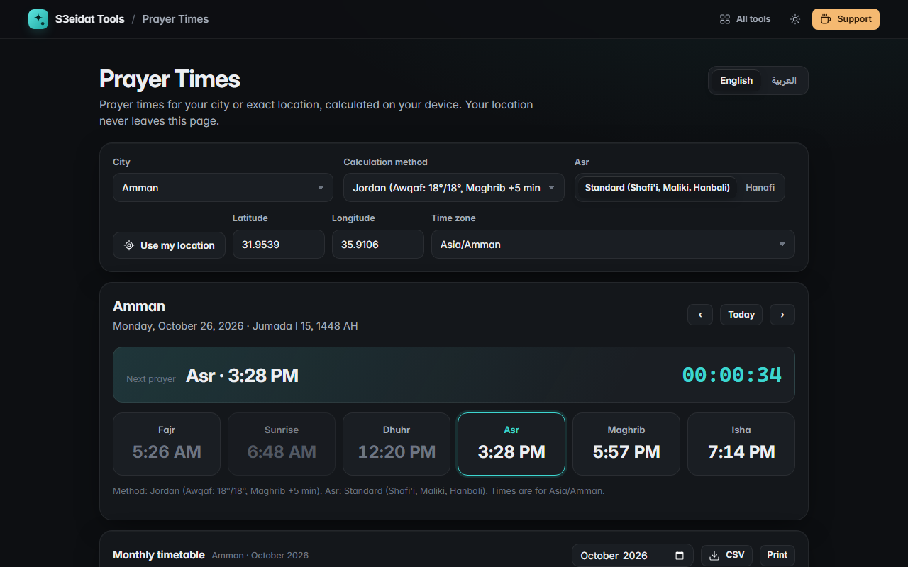

# Prayer Times

> Accurate prayer times for your location or any city, in English and Arabic (مواقيت الصلاة). Free, private, and it runs entirely in your browser.

### ▶ [Open Prayer Times](https://s3eidat.github.io/prayer-times/)



## Features

- **Your location** from the device (only when you click the button; it stays on the device) or **manual latitude/longitude**, plus 40+ **city presets** (Amman, Mecca, Medina, Cairo, Dubai, Istanbul, London, New York…)
- **Calculation methods**: Jordan (Awqaf), Muslim World League, Umm al-Qura, Egyptian, ISNA, Karachi, Dubai, Kuwait, Qatar, Turkey, Singapore, Tehran, Moonsighting Committee
- **Asr**: standard (Shafi'i, Maliki, Hanbali) or Hanafi; automatic high-latitude rule above 48°
- Today's Fajr, Sunrise, Dhuhr, Asr, Maghrib and Isha with a live **next-prayer countdown**; browse other days
- **Hijri date** (Umm al-Qura calendar from your browser)
- **Monthly timetable**: printable, or download as CSV
- **Bilingual**: full Arabic (right-to-left) and English interface
- Calculations by the open-source [adhan-js](https://github.com/batoulapps/adhan-js) library (MIT), bundled in the page

## Privacy

Your location and settings are saved only in your browser (localStorage). Coordinates are never sent anywhere. There is no server, no account, no analytics.
The page ships with a strict Content-Security-Policy (`connect-src 'self'`), so the browser
itself blocks any attempt to send data anywhere.

## Run it yourself

It's plain HTML, CSS and JavaScript with no build step:

```bash
git clone https://github.com/s3eidat/prayer-times
cd prayer-times
python -m http.server 8000
```

Then open http://localhost:8000.

## Support

If this saved you time, **[buy me a coffee ☕](https://s3eidat.github.io/coffee/)**. It keeps every tool free.

---

Part of **[S3eidat Tools](https://s3eidat.github.io/)**: 100+ free, private tools that run in your browser. MIT licensed.
